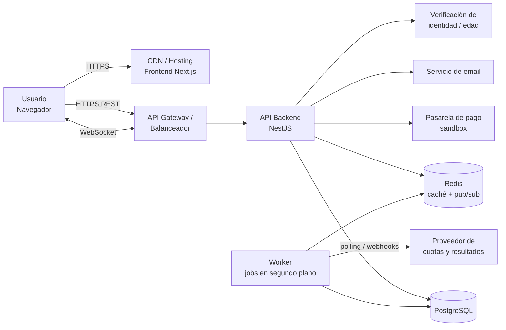
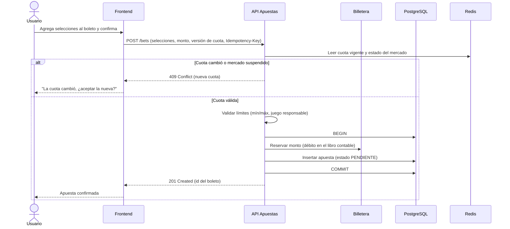
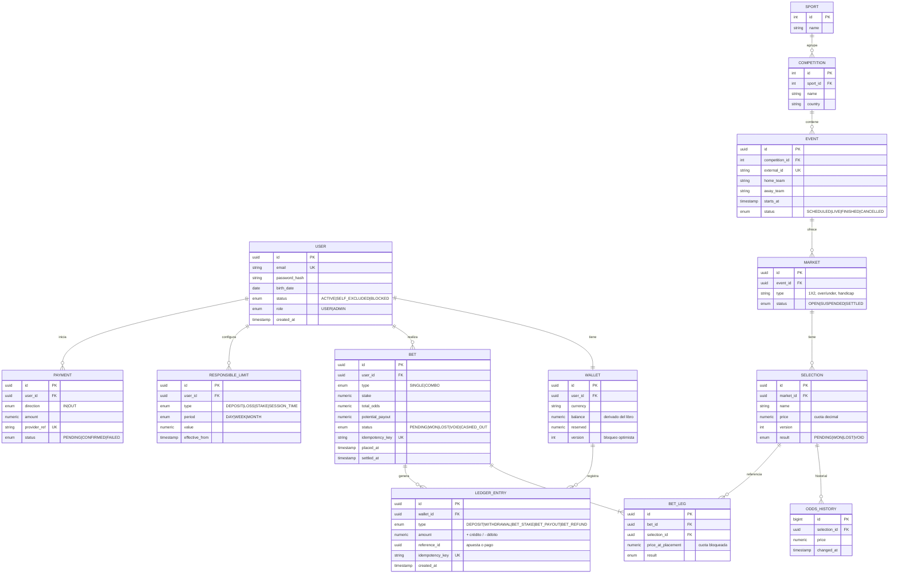
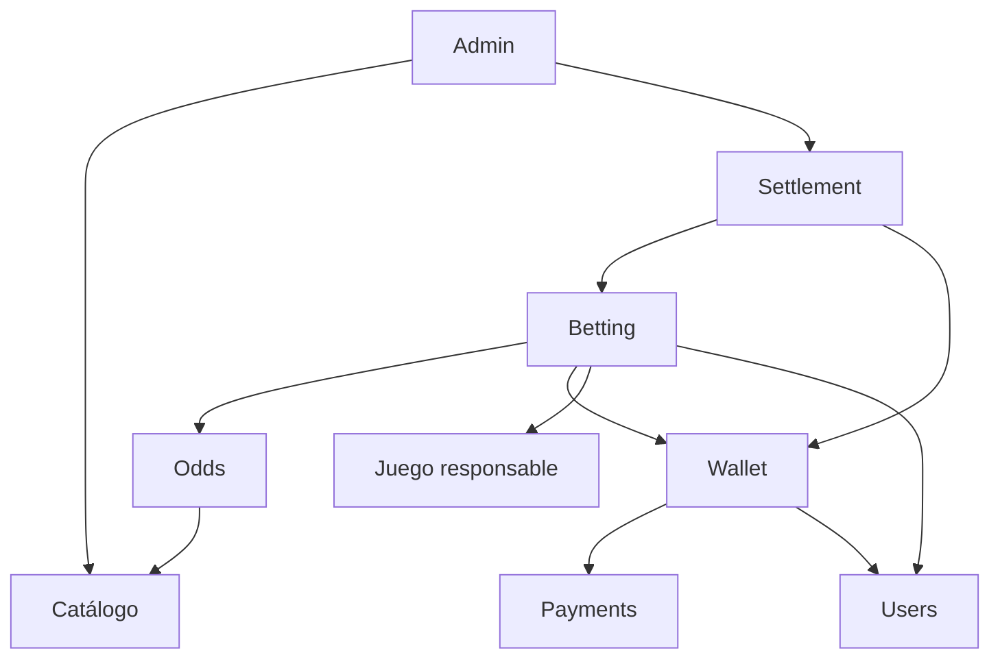
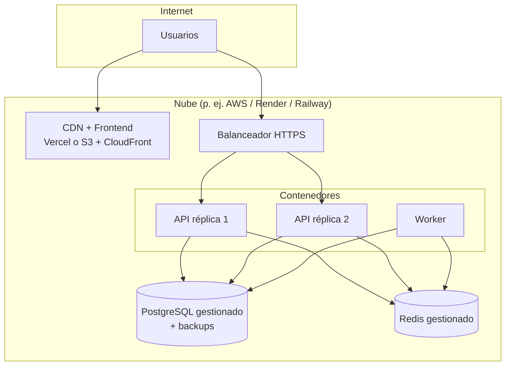
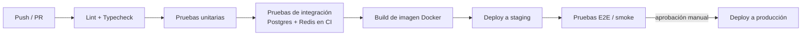

# Diseño Técnico — Plataforma Web de Apuestas Deportivas

> Borrador inicial para el proyecto del curso. Las decisiones marcadas con `<!-- REVISAR -->` son
> supuestos que conviene validar con el equipo o el docente.

**Supuestos generales**

- La app permite a usuarios registrados consultar eventos deportivos, ver cuotas (pre-partido y en
  vivo), realizar apuestas simples y combinadas, y gestionar un saldo.
- Para el curso se usa **saldo virtual / pasarela de pago en modo sandbox** — no dinero real.
  <!-- REVISAR: si se quisiera operar con dinero real se requieren licencia de juego, KYC completo y cumplimiento regulatorio del país. -->
- Las cuotas y resultados provienen de un **proveedor externo de datos deportivos** (API).
- Stack propuesto: React/Next.js + Node.js (NestJS) + PostgreSQL + Redis, empaquetado en Docker.
  <!-- REVISAR: ajustar al stack que exija o conozca el curso. -->

---

## 1. Arquitectura del sistema

Se propone una arquitectura de **monolito modular** con un *worker* separado para procesos en
segundo plano. Es más simple de construir y desplegar que microservicios, pero mantiene límites
claros entre módulos para poder separarlos después si hiciera falta.



**Estilo y principios**

| Principio | Aplicación |
|---|---|
| Monolito modular | Un solo backend dividido en módulos (usuarios, billetera, eventos, apuestas, liquidación, admin). |
| Separación lectura/escritura en tiempo real | Las cuotas se cachean en Redis y se difunden por WebSocket; PostgreSQL es la fuente de verdad. |
| Consistencia fuerte en dinero | Toda operación de saldo es transaccional (ACID) y registrada en un libro contable inmutable. |
| Procesos asíncronos | Ingesta de cuotas, liquidación de apuestas y notificaciones corren en el worker, fuera del ciclo de la petición HTTP. |
| Seguridad por defecto | HTTPS, JWT de corta duración, límites de peticiones, validación de entrada y auditoría. |

---

## 2. Componentes

### 2.1 Frontend (Next.js + React)

| Módulo | Responsabilidad |
|---|---|
| Catálogo de eventos | Lista de deportes, ligas y partidos; filtros; cuotas en vivo. |
| Boleto de apuesta (bet slip) | Selección de mercados, cálculo de ganancia potencial, confirmación. |
| Mi cuenta | Perfil, historial de apuestas, movimientos de saldo, límites de juego responsable. |
| Billetera | Depósitos y retiros (sandbox). |
| Panel de administración | Gestión de eventos, suspensión de mercados, liquidación manual, reportes. |

### 2.2 Backend (NestJS)

| Módulo | Responsabilidad |
|---|---|
| **Auth** | Registro, login, JWT + refresh token, recuperación de contraseña, 2FA opcional. |
| **Usuarios** | Perfil, verificación de edad (+18), estado de la cuenta (activa, autoexcluida, bloqueada). |
| **Billetera (Wallet)** | Saldo, libro contable, reservas de fondos al apostar, depósitos y retiros. |
| **Catálogo** | Deportes, competiciones, eventos, mercados y selecciones. |
| **Cuotas (Odds)** | Versión vigente de cada cuota, suspensión de mercados y difusión por WebSocket. |
| **Apuestas (Betting)** | Validación y registro de apuestas simples y combinadas; bloqueo de cuota. |
| **Liquidación (Settlement)** | Resolver apuestas al conocerse el resultado y acreditar ganancias. |
| **Juego responsable** | Límites de depósito y pérdida, autoexclusión, avisos de tiempo de sesión. |
| **Notificaciones** | Emails y avisos en la app (apuesta ganada, depósito confirmado…). |
| **Admin y auditoría** | Operaciones de backoffice y registro de acciones sensibles. |

### 2.3 Worker (procesos en segundo plano)

- **Ingesta de cuotas:** consulta al proveedor cada N segundos (o recibe webhooks), normaliza los
  datos, actualiza PostgreSQL y Redis y publica los cambios.
- **Ingesta de resultados:** detecta eventos finalizados y encola la liquidación.
- **Liquidación:** procesa apuestas pendientes de forma idempotente.
- **Tareas programadas:** conciliación de saldos, limpieza de sesiones y reportes diarios.

Cola de trabajos: **BullMQ sobre Redis**.

---

## 3. Flujos e interfaces

### 3.1 Flujo: realizar una apuesta



### 3.2 Flujo: liquidación

```mermaid
sequenceDiagram
    participant P as Proveedor de datos
    participant W as Worker
    participant DB as PostgreSQL
    participant N as Notificaciones

    P->>W: Resultado final del evento
    W->>DB: Marcar selecciones como GANADA / PERDIDA / ANULADA
    loop Por cada apuesta afectada
        W->>DB: BEGIN
        W->>DB: Evaluar la apuesta (una combinada gana solo si todas sus selecciones ganan)
        W->>DB: Si gana, acreditar la ganancia en el libro; si se anula, devolver el monto
        W->>DB: Actualizar el estado de la apuesta · COMMIT
        W->>N: Encolar notificación al usuario
    end
```

### 3.3 Flujo: depósito (sandbox)

1. El usuario solicita un depósito → `POST /wallet/deposits` y el backend crea una intención de pago.
2. El frontend redirige a la pasarela (checkout sandbox).
3. La pasarela llama al webhook `POST /webhooks/payments` con una firma verificable.
4. El backend valida la firma y la idempotencia y acredita el saldo en el libro contable.

### 3.4 Interfaces — API REST (resumen)

| Método | Endpoint | Descripción |
|---|---|---|
| POST | `/auth/register` | Registro (incluye fecha de nacimiento). |
| POST | `/auth/login` | Login y emisión de tokens. |
| POST | `/auth/refresh` | Renovar el token de acceso. |
| GET | `/sports` | Lista de deportes y competiciones. |
| GET | `/events?sport=&status=` | Eventos filtrados (próximos / en vivo). |
| GET | `/events/{id}/markets` | Mercados y cuotas de un evento. |
| POST | `/bets` | Crear apuesta (requiere `Idempotency-Key`). |
| GET | `/bets?status=` | Historial de apuestas del usuario. |
| GET | `/wallet` | Saldo disponible y reservado. |
| GET | `/wallet/transactions` | Movimientos del libro contable. |
| POST | `/wallet/deposits` | Iniciar depósito. |
| POST | `/wallet/withdrawals` | Solicitar retiro. |
| PUT | `/me/limits` | Configurar límites de juego responsable. |
| POST | `/me/self-exclusion` | Autoexclusión temporal o permanente. |
| POST | `/webhooks/payments` | Callback de la pasarela (firma HMAC). |
| — | `/admin/*` | Backoffice (rol ADMIN). |

**Interfaz en tiempo real (WebSocket / Socket.IO)**

| Canal | Mensaje |
|---|---|
| `odds:event:{id}` | `{ selectionId, price, version, status }` cuando cambia una cuota. |
| `market:event:{id}` | Mercado suspendido o reabierto. |
| `user:{id}` | Apuesta liquidada, saldo actualizado. |

**Interfaces externas**

| Sistema | Protocolo | Uso |
|---|---|---|
| Proveedor de cuotas (p. ej. The Odds API, API-Football) | REST + polling / webhooks | Eventos, cuotas y resultados. <!-- REVISAR: elegir un proveedor con plan gratuito. --> |
| Pasarela de pago (Stripe o Mercado Pago en modo test) | REST + webhooks | Depósitos y retiros simulados. |
| Email (SendGrid, Resend o SMTP) | REST / SMTP | Verificación de cuenta y notificaciones. |

---

## 4. Modelo de datos



**Reglas clave del modelo**

- **Libro contable inmutable:** `LEDGER_ENTRY` solo admite inserciones. El saldo es la suma de los
  asientos; `WALLET.balance` es un valor cacheado que se actualiza en la misma transacción.
- **Montos con `NUMERIC(18,2)`**, nunca `float`.
- **La cuota se congela al apostar:** `BET_LEG.price_at_placement` guarda la cuota aceptada, aunque
  después cambie.
- **Idempotencia:** `idempotency_key` único en apuestas y asientos evita duplicados por reintentos.
- **Índices:** `EVENT(status, starts_at)`, `BET(user_id, placed_at)`, `BET_LEG(selection_id)` y
  `LEDGER_ENTRY(wallet_id, created_at)`.
- **Auditoría:** una tabla `AUDIT_LOG` (actor, acción, entidad, antes/después, IP) para acciones
  administrativas.

---

## 5. Dependencias

### 5.1 Tecnológicas

| Capa | Tecnología | Motivo |
|---|---|---|
| Frontend | Next.js 15, React 19, TypeScript | SSR para SEO del catálogo, ecosistema maduro. |
| UI | Tailwind CSS, shadcn/ui | Desarrollo rápido y consistente. |
| Estado / datos | TanStack Query, Zustand (boleto) | Caché de peticiones y estado local del boleto. |
| Tiempo real | Socket.IO | Cuotas en vivo con reconexión automática. |
| Backend | Node.js 22 LTS, NestJS, TypeScript | Modularidad, inyección de dependencias, validación. |
| ORM | Prisma | Migraciones versionadas y tipado. |
| Base de datos | PostgreSQL 16 | Transacciones ACID para el dinero. |
| Caché / colas | Redis 7 + BullMQ | Cuotas en caché, pub/sub y jobs. |
| Autenticación | JWT (access + refresh), argon2 | Hash de contraseñas robusto. |
| Validación | class-validator / Zod | Validación de entradas. |
| Pruebas | Jest, Supertest, Playwright | Pruebas unitarias, de API y E2E. |
| Contenedores | Docker, Docker Compose | Entorno reproducible. |
| CI/CD | GitHub Actions | Build, pruebas y despliegue automáticos. |
| Observabilidad | Pino (logs), Prometheus + Grafana, Sentry | Métricas, alertas y errores. |

### 5.2 Servicios externos

| Servicio | Criticidad | Plan de contingencia |
|---|---|---|
| Proveedor de cuotas | **Alta** | Si deja de responder, suspender automáticamente los mercados afectados; nunca aceptar apuestas con cuotas desactualizadas. |
| Pasarela de pago | Media | Los depósitos quedan `PENDING` y la conciliación se reintenta. |
| Email | Baja | Reintentos en cola; la app sigue funcionando. |

### 5.3 Dependencias entre módulos



Regla: **solo el módulo Wallet modifica saldos**; los demás lo invocan a través de su interfaz.

---

## 6. Despliegue

### 6.1 Entornos

| Entorno | Propósito | Datos |
|---|---|---|
| Local | Desarrollo con Docker Compose | Semillas ficticias. |
| Staging | Pruebas integradas y demo del curso | Proveedor de cuotas y pagos en modo test. |
| Producción | Uso final | <!-- REVISAR: probablemente no aplique en el curso; staging puede hacer de "producción" de la demo. --> |

### 6.2 Topología



- Frontend en **Vercel** (o S3 + CloudFront).
- API y worker como **contenedores Docker** en Render, Railway, Fly.io o AWS ECS.
  <!-- REVISAR: elegir según los créditos o la plataforma del curso. -->
- PostgreSQL y Redis **gestionados**, con backups diarios.
- Los WebSockets requieren *sticky sessions* o el adaptador Redis de Socket.IO para escalar a
  varias réplicas.

### 6.3 Pipeline CI/CD



- Las migraciones de base de datos corren como paso previo al despliegue (`prisma migrate deploy`).
- Los secretos se guardan en el gestor de la plataforma, nunca en el repositorio.
- Rollback: redesplegar la imagen anterior; las migraciones deben ser compatibles hacia atrás.

---

## 7. Operación

### 7.1 Monitoreo y alertas

| Métrica | Umbral de alerta |
|---|---|
| Latencia p95 de `POST /bets` | > 500 ms |
| Tasa de errores 5xx | > 1 % en 5 min |
| Antigüedad de la última cuota recibida | > 60 s en eventos en vivo → suspender mercados |
| Cola de liquidación pendiente | > 1 000 jobs o > 10 min de espera |
| Descuadre en la conciliación de saldos | Cualquier diferencia ≠ 0 |
| Fallos de webhooks de pago | > 3 consecutivos |

Paneles en Grafana (negocio: apuestas por minuto, volumen apostado, margen; técnico: CPU, memoria,
conexiones a la base de datos, WebSockets activos).

### 7.2 Registros y auditoría

- Logs estructurados en JSON con `requestId` y `userId`, sin datos sensibles (contraseñas, tarjetas).
- Retención: 30 días de logs de aplicación y 5 años de auditoría y transacciones.
  <!-- REVISAR: el plazo regulatorio depende del país. -->

### 7.3 Seguridad operativa

- HTTPS obligatorio y cabeceras de seguridad (HSTS, CSP).
- Límite de peticiones por IP y por usuario en login y apuestas.
- Bloqueo tras varios intentos fallidos de login.
- Roles con mínimo privilegio; 2FA obligatorio para administradores.
- Dependencias revisadas con `npm audit` y Dependabot.
- Protección OWASP Top 10: consultas parametrizadas vía ORM, validación de entrada, CSRF en
  cookies y sanitización de salida.

### 7.4 Procedimientos (runbooks)

| Situación | Acción |
|---|---|
| El proveedor de cuotas se cae | Suspensión automática de mercados, aviso en la UI y reactivación tras recibir datos frescos. |
| Resultado erróneo del proveedor | El admin revierte la liquidación (asientos compensatorios, nunca borrados) y reliquida. |
| Evento cancelado | Marcar las selecciones como `VOID` y devolver los montos automáticamente. |
| Descuadre de saldo | Congelar la billetera afectada, revisar el libro contable y corregir con un asiento de ajuste auditado. |
| Caída de la base de datos | Conmutar a la réplica o restaurar el backup (RPO ≤ 24 h, RTO ≤ 4 h para el curso). |

### 7.5 Juego responsable (operación continua)

- Verificación de edad (+18) en el registro.
- Límites configurables por el usuario; las subidas de límite tienen un periodo de espera de 24 h.
- La autoexclusión bloquea el login a la zona de apuestas durante el periodo elegido.
- Enlaces visibles a ayuda sobre la ludopatía.

### 7.6 Backups y mantenimiento

- Backup diario automático de PostgreSQL con 7 días de retención y prueba mensual de restauración.
- Ventanas de mantenimiento anunciadas en la app; los mercados se suspenden durante el
  mantenimiento.
